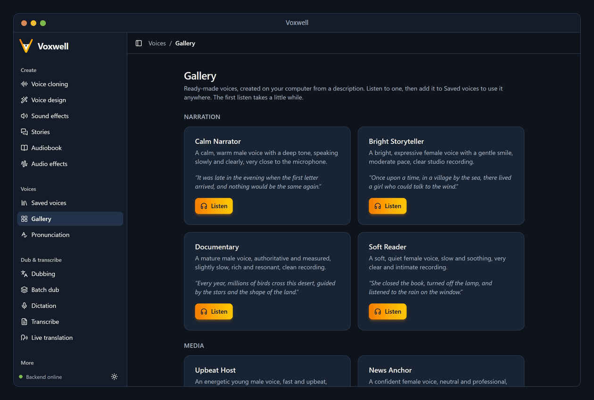
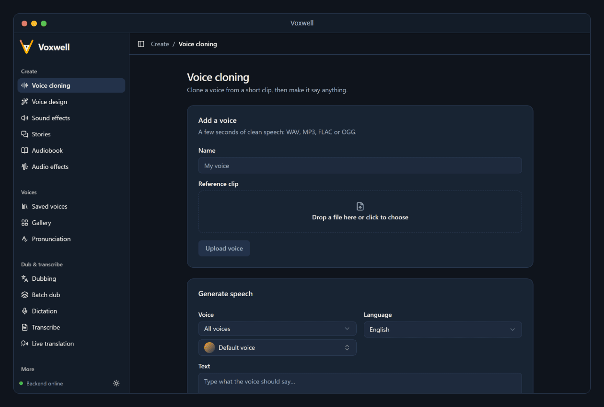
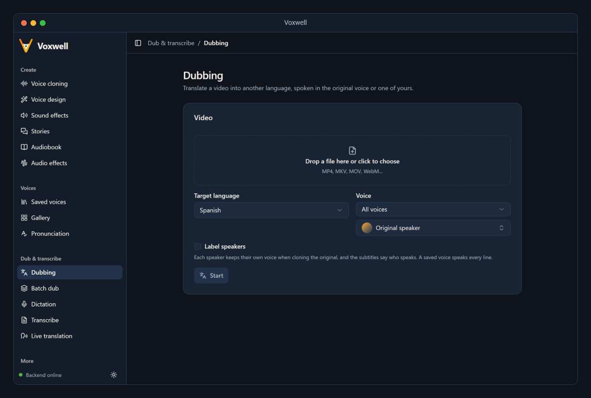
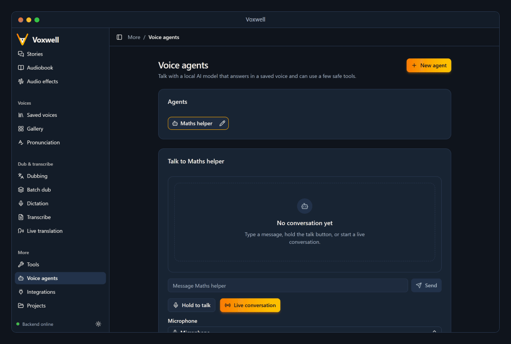
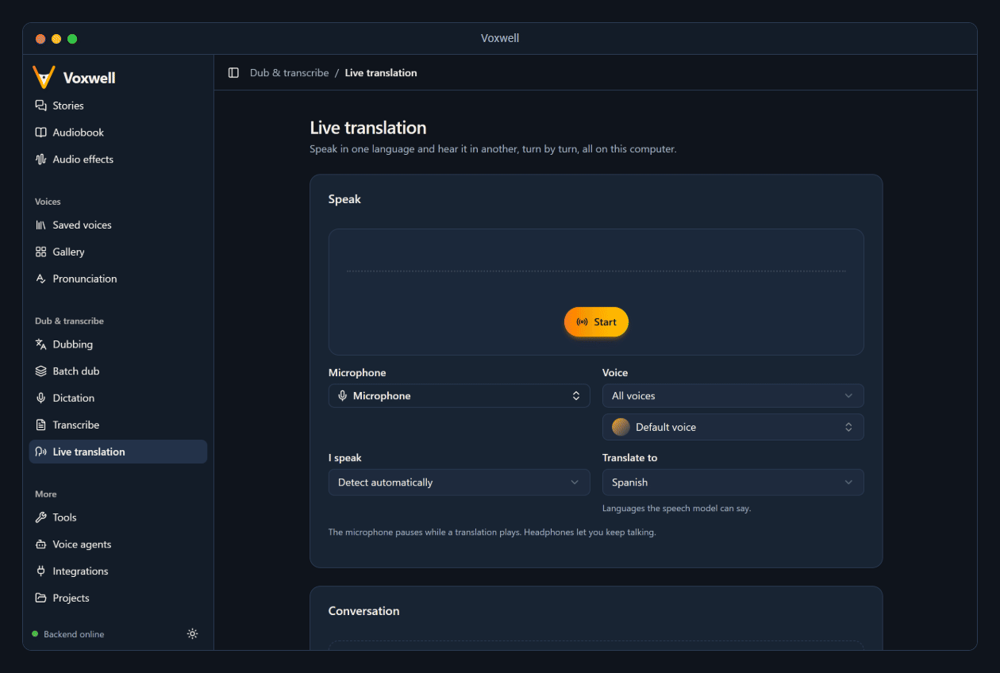
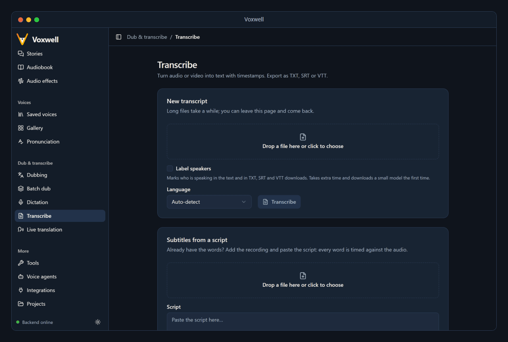
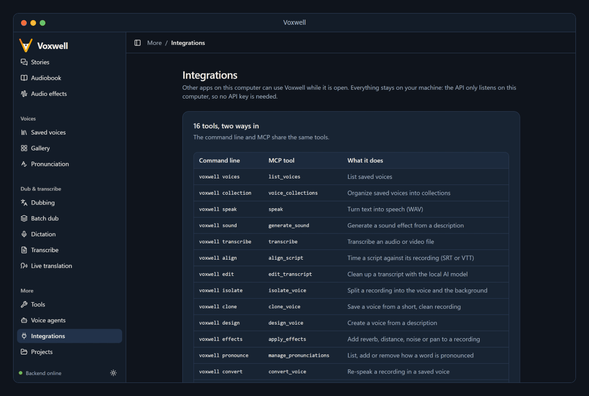

<div align="center">

<picture>
  <source media="(prefers-color-scheme: dark)" srcset="docs/design/voxwell-lockup-dark.svg" />
  <source media="(prefers-color-scheme: light)" srcset="docs/readme/voxwell-lockup-light.svg" />
  
</picture>

<h3>A complete voice studio that runs on your own machine.</h3>

<p>
  <em>Clone and design voices, dub videos, transcribe, translate live and talk to voice agents.</em><br/>
  <em>Every model runs locally. Your voices and recordings never leave your computer.</em>
</p>

<p>
  <a href="https://voxwell.vercel.app"></a>
  <a href="https://github.com/Troy2727/voxwell/actions/workflows/ci.yml"></a>
  <a href="https://www.python.org"></a>
  <a href="https://fastapi.tiangolo.com"></a>
  <a href="https://pytorch.org"></a>
  <a href="https://huggingface.co"></a>
  <a href="https://docs.astral.sh/uv/"></a>
  <a href="https://ffmpeg.org"></a>
  <a href="https://react.dev"></a>
  <a href="https://www.typescriptlang.org"></a>
  <a href="https://vite.dev"></a>
  <a href="https://tailwindcss.com"></a>
  <a href="https://ui.shadcn.com"></a>
  <a href="https://www.electronjs.org"></a>
  <a href="https://supabase.com"></a>
  <a href="https://vercel.com"></a>
  <a href="https://github.com/features/actions"></a>
  <a href="LICENSE"></a>
</p>

<p>
  <a href="#-features">Features</a> ·
  <a href="#-how-it-fits-together">Architecture</a> ·
  <a href="#-how-dubbing-works">Dubbing</a> ·
  <a href="#-quick-start">Quick start</a> ·
  <a href="#-integrations">Integrations</a> ·
  <a href="#-models-and-licenses">Models</a>
</p>

<br/>

<a href="https://github.com/Troy2727/voxwell/blob/main/docs/readme/screenshots/animated/tour.gif" title="Open this screenshot full size">
  
</a>
<br />
<sub>Click the screenshot to see it full size.</sub>

</div>

<br/>

##  What is Voxwell?

Voxwell is a **local-first voice studio**: voice cloning, voice design, video dubbing, dictation, transcription, live translation and voice agents in one desktop app. One local server runs open models on your CPU or GPU, and the app, the `voxwell` command line, an MCP server and an OpenAI-compatible API all share it.

> No cloud service, no per-minute billing, no uploads. Model weights download once, on first use; after that, everything happens on your machine.

Voxwell is **MIT licensed**, and every model it runs allows commercial use ([one documented exception](#-models-and-licenses)). A test fails the build if a GPL, AGPL or non-commercial package is ever installed.

<br/>

##  Take a look

<table>
  <tr>
    <td width="50%" valign="top">
      <a href="https://github.com/Troy2727/voxwell/blob/main/docs/readme/screenshots/animated/voice-cloning.gif" title="Open this screenshot full size">
        
      </a>
      <p><b>Voice cloning</b><br/><sub>Upload a few seconds of speech, then make it say anything.</sub></p>
    </td>
    <td width="50%" valign="top">
      <a href="https://github.com/Troy2727/voxwell/blob/main/docs/readme/screenshots/animated/dubbing.gif" title="Open this screenshot full size">
        
      </a>
      <p><b>Dubbing</b><br/><sub>Pick a language; keep the original voice or use one of yours.</sub></p>
    </td>
  </tr>
  <tr>
    <td width="50%" valign="top">
      <a href="https://github.com/Troy2727/voxwell/blob/main/docs/readme/screenshots/animated/voice-agents.gif" title="Open this screenshot full size">
        
      </a>
      <p><b>Voice agents</b><br/><sub>Type, hold to talk, or have a live conversation.</sub></p>
    </td>
    <td width="50%" valign="top">
      <a href="https://github.com/Troy2727/voxwell/blob/main/docs/readme/screenshots/animated/live-translation.gif" title="Open this screenshot full size">
        
      </a>
      <p><b>Live translation</b><br/><sub>Speak one language, hear another, turn by turn.</sub></p>
    </td>
  </tr>
  <tr>
    <td width="50%" valign="top">
      <a href="https://github.com/Troy2727/voxwell/blob/main/docs/readme/screenshots/animated/transcribe.gif" title="Open this screenshot full size">
        
      </a>
      <p><b>Transcribe</b><br/><sub>TXT, SRT or VTT, with speaker labels or your own script.</sub></p>
    </td>
    <td width="50%" valign="top">
      <a href="https://github.com/Troy2727/voxwell/blob/main/docs/readme/screenshots/animated/integrations.gif" title="Open this screenshot full size">
        
      </a>
      <p><b>Integrations</b><br/><sub>Every CLI command, with its matching MCP tool.</sub></p>
    </td>
  </tr>
</table>

<p align="center"><sub>Click any screenshot to see it full size.</sub></p>

<br/>

##  Features

**Voices**

| Feature | What it does |
| --- | --- |
| **Voice cloning** | Clone a voice from a few seconds of clean speech. Saved voices work everywhere in the app. |
| **Voice design** | Describe a voice ("warm, low, slight British accent") and Voxwell creates it. |
| **Gallery** | Start from a ready-made voice. |
| **Collections** | Keep saved voices organized in folders. |
| **Pronunciation** | Teach every voice how to say names, brands and jargon. Each language has one list, and it applies to all speech. |

**Speech and sound**

| Feature | What it does |
| --- | --- |
| **Stories** | A script with a different voice for each speaker. |
| **Audiobook** | EPUB, TXT or Markdown, chapter by chapter. You can stop and resume. |
| **Effects** | Add reverb, distance, background noise or stereo pan, to any recording or while generating in Voice cloning and Stories. |
| **Sound effects** | Describe a sound and generate it with Stable Audio Open. Needs a free Hugging Face token and accepting the model's terms. |

**Video and translation**

| Feature | What it does |
| --- | --- |
| **Dubbing** | Dub one video, a batch, or every video dropped into a watched folder. It can keep each speaker's own voice. |
| **Live translation** | Speak in one language and hear the translation in another, turn by turn, in a saved voice or the default one. |

**Listening and text**

| Feature | What it does |
| --- | --- |
| **Dictation** | Record and transcribe, or go live: each turn is transcribed when you pause. |
| **Transcribe** | TXT, SRT or VTT, with optional speaker labels ("Speaker 1", "Speaker 2"). |
| **Transcript clean-up** | A local AI model removes filler words, fixes punctuation or makes the text formal. |
| **Subtitles from a script** | Paste a script you already have, add the recording, and every word is timed against the audio. |

**AI and tools**

| Feature | What it does |
| --- | --- |
| **Voice agents** | Talk with a local AI model, live or push-to-talk. It answers in a saved voice and can use a few safe, read-only tools: the time, a calculator and your saved voices. |
| **AI direction** | Describe how a line should sound, and a local AI model sets the delivery. |
| **Voice tools** | Convert a recording to another voice, isolate a voice from music and noise, compare voices, fit audio to a length, inspect media files. |
| **Projects** | Everything you make, in one list. |

<br/>

##  How it fits together

<p align="center">
  <a href="https://github.com/Troy2727/voxwell/blob/main/docs/readme/diagrams/animated/architecture-dark.gif" title="Open this diagram full size">
    <picture>
      <source media="(prefers-color-scheme: dark)" srcset="docs/readme/diagrams/animated/architecture-dark.gif" />
      <source media="(prefers-color-scheme: light)" srcset="docs/readme/diagrams/animated/architecture-dark.gif" />
      
    </picture>
  </a>
  <br />
  <sub>Click the diagram to see it full size.</sub>
</p>

There is **one server, and it only listens on `127.0.0.1`.** The desktop app starts it, and every other way in is a client of the same HTTP API, so each model loads once and is shared by all of them. Each feature is a folder in `backend/voxwell/features/` with its own FastAPI router, mounted at `/api/<feature>/`.

Models load **lazily**, on the first request that needs them, and use CUDA, then Apple MPS, then the CPU. Voices, projects and results are saved in a local data folder.

<br/>

##  How dubbing works

<p align="center">
  <a href="https://github.com/Troy2727/voxwell/blob/main/docs/readme/diagrams/animated/dubbing-dark.gif" title="Open this diagram full size">
    <picture>
      <source media="(prefers-color-scheme: dark)" srcset="docs/readme/diagrams/animated/dubbing-dark.gif" />
      <source media="(prefers-color-scheme: light)" srcset="docs/readme/diagrams/animated/dubbing-dark.gif" />
      
    </picture>
  </a>
  <br />
  <sub>Click the diagram to see it full size.</sub>
</p>

Dubbing chains features that also work on their own: **dictation** transcribes, **voice cloning** speaks. By default each line is spoken in the **original speaker's cloned voice**; with speaker labels on, every speaker gets their own clone. Pick a saved voice instead and it speaks every line.

Each new clip is sped up if it runs long, then trimmed to the gap before the next line, so the dub stays in sync with the picture. You get an `.mp4` and a matching `.srt`.

<br/>

##  Quick start

**Requirements:** [uv](https://docs.astral.sh/uv/) (it installs Python 3.11 for you), [Node.js](https://nodejs.org/) and [ffmpeg](https://ffmpeg.org/) on your `PATH`. ffmpeg is used for dubbing and some tools.

```sh
git clone https://github.com/Troy2727/voxwell.git && cd voxwell

cd backend && uv sync && uv run pytest     # backend + tests
cd app && npm install && npm run dev       # UI on http://localhost:5173
cd app && VOXWELL_DEV=1 npm run electron   # desktop shell (starts the backend)
cd backend && uv run voxwell --help        # the CLI; its commands need the backend running
```

Model weights download on first use of each feature.

<details>
<summary><b>GPUs, proxies and antivirus</b></summary>

<br/>

- **GPU.** Windows and Linux get CUDA builds of PyTorch, which run on the CPU when there is no NVIDIA GPU. macOS uses Apple's GPU (MPS) when available.
- **HTTPS inspection.** Behind a proxy or antivirus that inspects HTTPS, set `UV_SYSTEM_CERTS=1` for the `uv` commands above. The desktop app sets it for you, and the backend itself always trusts the OS certificate store.
- **Port.** The server listens on `127.0.0.1:8765`. Set `VOXWELL_PORT` to change it.

</details>

<details>
<summary><b>Common commands</b></summary>

<br/>

| Where | Command | Purpose |
| :-: | --- | --- |
| `backend/` | `uv sync` | Install the backend and its models' packages |
| `backend/` | `uv run pytest` | Run the backend tests |
| `backend/` | `uv run voxwell` | Start the server on `127.0.0.1:8765` |
| `app/` | `npm run dev` | Vite dev server on `:5173` |
| `app/` | `npm run typecheck` | TypeScript check |
| `app/` | `npm run build` | Typecheck and production build |
| `app/` | `VOXWELL_DEV=1 npm run electron` | Desktop shell against the dev server |

</details>

<br/>

##  The website

[voxwell.vercel.app](https://voxwell.vercel.app) is the same UI, hosted. It does no work itself: it talks to the Voxwell backend on your own computer (`http://127.0.0.1:8765`), so start Voxwell first (the desktop app, or `uv run voxwell` in `backend`). Until it is running, the site says so. Chrome asks once whether the site may connect to apps on your device; choose **Allow**.

<br/>

##  Integrations

The app's **Integrations** page shows how to connect each of these.

**Command line.** The `voxwell` command can speak, transcribe, edit, align, isolate, clone, design, convert, dub, translate and chat with an agent. Add `--json` to any command for one JSON object per run, ready for scripts.

```sh
voxwell speak "Welcome to the show." --voice Narrator -o welcome.wav
voxwell transcribe interview.mp4 -f srt -o interview.srt
voxwell dub talk.mp4 --to es --speakers        # keep each speaker's own voice
voxwell isolate song.mp3                        # song.voice.wav + song.background.wav
```

**Agent skill.** The Integrations page installs a skill that teaches Claude Code and Codex to use the `voxwell` CLI. Its source is in [`skills/voxwell/SKILL.md`](skills/voxwell/SKILL.md).

**MCP server.** `voxwell-mcp` gives AI assistants like Claude Desktop, Cursor and Claude Code the same commands as tools. It forwards each call to the running app, so models still load only once.

**OpenAI-compatible API.** Point any OpenAI SDK at `http://127.0.0.1:8765/v1`. It supports `audio/speech` (any saved voice) and `audio/transcriptions` (JSON, text, SRT or VTT).

```sh
curl http://127.0.0.1:8765/v1/audio/speech \
  -H "Content-Type: application/json" \
  -d '{"input": "Hello from Voxwell.", "voice": "Narrator", "response_format": "mp3"}' \
  -o hello.mp3
```

**Phone calls (optional).** Callers to your Twilio number hear a greeting in one of your voices. This is off by default. When on, it runs a separate small server that serves only Twilio's two endpoints, so the main app is never exposed.

<br/>

##  Models and licenses

Every model runs locally. Its license is recorded in its feature's `backend/voxwell/features/<feature>/LICENSES.md`.

| Model | Used for | License |
| --- | --- | --- |
| [Chatterbox Multilingual](https://huggingface.co/ResembleAI/chatterbox) | Voice cloning, speech, dubbing, voice conversion | MIT |
| [Parler-TTS Mini v1](https://huggingface.co/parler-tts/parler-tts-mini-v1) | Voice design | Apache-2.0 |
| [faster-whisper](https://github.com/SYSTRAN/faster-whisper) (Whisper small) | Dictation, transcription | MIT |
| [sherpa-onnx](https://github.com/k2-fsa/sherpa-onnx) with pyannote segmentation and 3D-Speaker | Speaker labels | Apache-2.0, MIT |
| [M2M100 418M](https://huggingface.co/facebook/m2m100_418M) | Translation | MIT |
| [Qwen2.5-1.5B-Instruct](https://huggingface.co/Qwen/Qwen2.5-1.5B-Instruct) | AI direction, transcript clean-up, voice agents | Apache-2.0 |
| HTDemucs | Voice isolation | MIT |
| [Stable Audio Open 1.0](https://huggingface.co/stabilityai/stable-audio-open-1.0) | Sound effects | Stability AI Community License |

> **The rule:** code and weights must both allow commercial use. Stable Audio Open is the one owner-approved exception: its license is free below US$1M in annual revenue. `backend/tests/test_dependency_licenses.py` fails if a GPL, AGPL or non-commercial package is ever installed.
>
> That is also why voice cloning and dubbing don't support Japanese: the model's Japanese support depends on a GPL-3.0 package.

<br/>

##  Accounts (optional)

Sign-in is off unless the app is built with a [Supabase](https://supabase.com) project. Without one, the app opens straight to the dashboard. To turn it on, set the project's URL and publishable key when you run or build the UI:

```sh
cd app && VITE_SUPABASE_URL=https://<project>.supabase.co VITE_SUPABASE_PUBLISHABLE_KEY=<publishable key> npm run dev
```

In the Supabase dashboard, under **Authentication > URL Configuration**, add `http://localhost:5173` and `voxwell://auth/callback` (the desktop app's sign-in link) to the redirect URLs. For "Continue with Google", enable the Google provider there with your Google OAuth client.

Accounts only control who can open the app. Voices, audio and models stay on your machine.

<br/>

##  Tech stack

**Backend**<br/>
<a href="https://www.python.org"></a>
<a href="https://fastapi.tiangolo.com"></a>
<a href="https://pytorch.org"></a>
<a href="https://huggingface.co"></a>
<a href="https://docs.astral.sh/uv/"></a>
<a href="https://ffmpeg.org"></a>

**App**<br/>
<a href="https://react.dev"></a>
<a href="https://www.typescriptlang.org"></a>
<a href="https://vite.dev"></a>
<a href="https://tailwindcss.com"></a>
<a href="https://ui.shadcn.com"></a>
<a href="https://www.electronjs.org"></a>
<a href="https://supabase.com"></a>

**CI**<br/>
<a href="https://github.com/features/actions"></a>
Backend tests on Ubuntu, Windows and macOS, plus a frontend typecheck and build, on every pull request and every push to `main`.

<br/>

##  Author

**Alex Mieses** · [GitHub](https://github.com/Troy2727)

Alex builds Voxwell end to end: the choice of voice models, the FastAPI backend, the React and Electron app, and the integrations that let AI assistants use it. Voxwell exists so that a complete voice studio can run on your own machine, with no cloud service, no per-minute billing and no uploads.

Before software, Alex spent about ten years in cybersecurity, and Voxwell is built that way. The server only listens on your own computer. The optional phone gateway is the only part that can ever be exposed, and it rejects any request without a valid Twilio signature. A test fails the build if a dependency's license ever stops allowing commercial use.

<br/>

##  Contributing

Read [`CONTRIBUTING.md`](CONTRIBUTING.md) first. In short: one folder per feature, heavy imports inside functions so the app starts fast, a CLI command and MCP tool for every user-facing feature, and only permissively licensed code and models. Never copy from GPL or AGPL projects.

<details>
<summary><b>Repository layout</b></summary>

```
voxwell/
├── backend/
│   ├── voxwell/
│   │   ├── main.py              # FastAPI app: mounts every feature at /api/<feature>/
│   │   ├── cli.py               # the `voxwell` command (no arguments: start the server)
│   │   └── features/<feature>/  # one folder per feature: router.py, its logic, LICENSES.md
│   └── tests/                   # pytest, incl. the dependency license check
│
├── app/
│   ├── src/
│   │   ├── features/<feature>/  # Page.tsx for each backend feature
│   │   ├── components/          # shared page pieces + ui/ (shadcn/ui, ElevenLabs UI)
│   │   └── auth/                # optional Supabase sign-in
│   └── electron/                # desktop shell: starts the backend, handles sign-in links
│
├── skills/voxwell/              # agent skill for Claude Code and Codex
├── docs/                        # logo, brand lockups, README diagrams, icons and screenshots
└── CONTRIBUTING.md
```

</details>

<br/>

##  License

[MIT](LICENSE). Each model keeps its own license; see [Models and licenses](#-models-and-licenses).

<br/>

<div align="center">

<b>Built with FastAPI, React 19 and open models that never leave your machine.</b>

<br/><br/>


</div>
